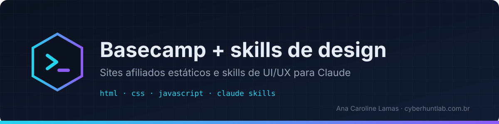

<p align="center"></p>

# Basecamp — site afiliado de equipamentos de camping e skills de design para Claude Code

Repositório com dois conjuntos de arquivos:

1. **Sites afiliados estáticos** (HTML/CSS/JavaScript), em inglês, para o público dos EUA:
   - `camping-site/` — **Basecamp**, um catálogo de equipamentos de camping por estação, categoria e produto, com links de afiliado;
   - `affiliate-site/` — **TopPicks**, uma página de ofertas e análises de produtos.
2. **Skills de design para o Claude Code** em `.claude/skills/`, usadas para criar e revisar interfaces.

## Recursos

### Basecamp (`camping-site/`)

- **Página inicial** e páginas por estação: primavera, verão, outono e inverno.
- **Categorias**: vestuário, mochilas, cozinha, coolers, calçados, hidratação, iluminação, sacos de dormir e isolantes.
- **43 páginas de produto** com descrição e link de compra.
- **Gaveta lateral e alternância de tema** claro/escuro compartilhadas (`sidebar.js`), com preferência salva no navegador.
- **Interações de toque**: carrossel com rolagem e arraste e zoom por pinça nas fotos.
- Tipografia Outfit e paleta definida por variáveis CSS (`season.css`).

### Skills (`.claude/skills/`)

| Skill | Conteúdo |
|---|---|
| `ui-ux-pro-max` | Guia pesquisável de estilos, paletas, pares de fontes, diretrizes de UX, ícones e stacks |
| `ui-styling` | Estilização de interfaces |
| `design-system` | Tokens (primitivos, semânticos, de componente), integração com Tailwind e geração de slides |
| `design` | Logos, ícones e identidade visual, com scripts que usam a API do Gemini |
| `brand` | Diretrizes de marca, paletas, tipografia e scripts de sincronização de tokens |
| `banner-design`, `slides` | Banners e apresentações |

## Instalação

Não há dependências para os sites.

```bash
git clone https://github.com/ticarollamas-arch/arquivo.md.git
cd arquivo.md
```

As skills são carregadas automaticamente pelo Claude Code quando a pasta `.claude/skills/` está no projeto. Alguns scripts das skills exigem Python ou Node.js e, no caso das skills de imagem, a variável `GEMINI_API_KEY`.

## Como usar

Sirva os sites com qualquer servidor estático:

```bash
python3 -m http.server 8000
# http://localhost:8000/camping-site/   e   http://localhost:8000/affiliate-site/
```

Para publicar, envie a pasta desejada a um host estático (GitHub Pages, Netlify, Vercel). Informe aos visitantes a natureza afiliada dos links.

## Tecnologias

HTML5 · CSS (variáveis, tema escuro) · JavaScript · Google Fonts (Outfit) · Claude Code Skills · Python · Node.js

## Licença

Este repositório ainda **não tem licença única definida**. As skills em `.claude/skills/` vêm de terceiros e mantêm suas próprias licenças (por exemplo, `ui-styling/LICENSE.txt`, Apache 2.0). Defina uma licença para os sites antes de redistribuí-los.
